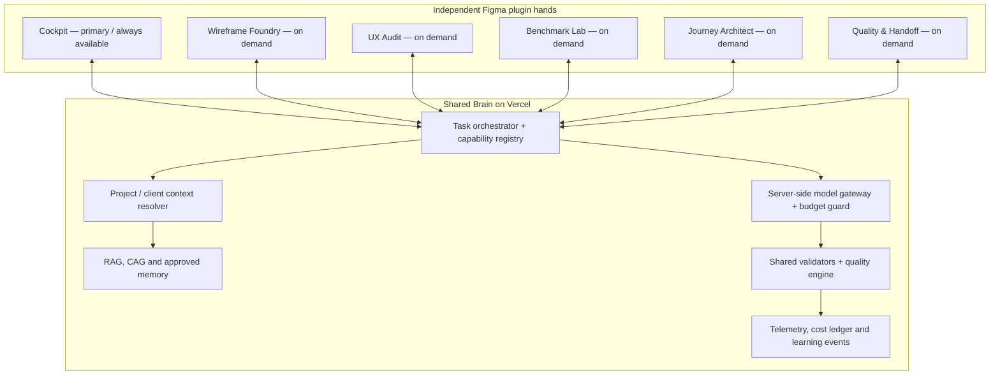

# UX Direct — Modular Hands Architecture

**Status:** architecture branch proposal  
**Branch:** `feature/modular-ux-hands-architecture`  
**Product repository:** `Zunaidscreenroot/ux-direct`

## Product model

UX Direct has **one Brain, one always-on primary hand, and multiple on-demand specialist hands**.

- **Brain (shared Vercel backend):** task orchestration, project context resolution, RAG/CAG, approved memory, model routing, budget guards, schemas, quality policies, telemetry and learning events.
- **Cockpit (primary hand):** the daily 24×7 design-and-audit work surface. It is used throughout a project and can call the shared Brain for planning and model inference.
- **Specialist hands:** separately installable Figma plugins for tasks that benefit from specialised UI and execution flows. They share the Brain and never duplicate its model gateway or project memory services.

"24×7" describes Cockpit's role as the always-available primary work surface; it does not imply that background inference runs continuously without a user task.

## Project workflows

### Existing / brownfield projects: DMI

DMI is an existing client with established files, screens, patterns, and working knowledge. DMI work uses Brain + Cockpit by default. It does **not** automatically trigger a greenfield foundation workflow.

Specialist hands can be invoked on demand for a complex journey, a benchmark study, a deeper UX audit, or a major new pattern. Keep these project profiles distinct:
- `dmi-hfc` — DMI Housing Finance
- `dmi-finance` — DMI Finance
- `dmi-wealth` — DMI Wealth

They may share approved client-level context, but client-wide facts must not silently overwrite project-specific patterns, rules or reference screens.

### New / greenfield project: Ujjivan Small Finance Bank

Ujjivan starts with no assumed approved project design system. The Brain coordinates an initial foundation sequence using specialist hands when appropriate:

1. Requirements and source/reference intake.
2. Public/approved benchmark research, with provenance.
3. Journey and state architecture.
4. High-fidelity wireframe kit generation (not the final UI design system).
5. Human review and approval of the kit and its manifest.
6. Cockpit generates and iterates actual screens/journeys using that approved kit.
7. Independent UX audit, visual QA and handoff when needed.

This is a **conditional plan**, not a rigid waterfall. After setup, Cockpit remains the primary hand for daily work. A later Ujjivan task can use Cockpit directly and invoke specialists only where needed.

## Target system diagram

## Responsibility boundaries

### Brain owns

- Task IDs, workflow state, capability discovery and orchestration.
- Model/provider selection, modality checks, retry limits, token limits, spending reservations and reported-usage reconciliation.
- Project isolation, context retrieval, source provenance, approved memory and knowledge versioning.
- Shared input/output schemas, policy checks, quality rubrics, telemetry, and explainable execution traces.
- Approval policy for operations that mutate designs or have a material cost.

### Each hand owns

- Its own Figma `manifest.json`, UI, plugin entry point, local interaction and specialised presentation.
- Gathering only the Figma context needed for its active task.
- Reading the approved target selection/frame and executing only its allowed Figma operations.
- Reporting operation results and evidence back to the Brain; it must not claim a design mutation succeeded on the basis of a model response alone.

### Shared contracts, not duplicated brains

The plugins use one versioned backend request/response contract. A hand sends its `handId`, `capabilityId`, project ID, task intent, selected frame/reference context and a request/correlation ID. The backend validates identity, allowed capability, project scope, cost and schema before orchestration. Model routing and prompt policy are owned by the Brain, not copied into each plugin.

The Brain returns a validated plan or task result with the required output schema and execution instructions. The plugin applies permitted Figma changes, then returns execution evidence for validation. Use idempotency keys to avoid duplicate paid requests when transport retries occur.

## Specialist hands and capabilities

| Hand | Core capabilities | When to invoke |
|---|---|---|
| Cockpit | Generate/redesign screens, variations, routine audits, component reuse, responsive adaptation and iteration | Default daily work for every project |
| Wireframe Foundry | Reference analysis, foundations, component/state library, BFCI patterns, journey templates, handoff manifest and versioning | Initial Ujjivan setup; later only to create/refine the high-fidelity wireframe kit |
| UX Audit | Heuristic/visual/form/content/accessibility/trust review, edge-state coverage and prioritised findings | Deep or independent audits; Cockpit retains routine checks |
| Benchmark Lab | Competitor research, flow/pattern comparison, evidence capture and source-linked recommendations | Greenfield foundation or a specific research question |
| Journey Architect | Requirements decomposition, IA, journey branches, data/state modelling, error recovery and screen specifications | Initial Ujjivan foundations or complex/new journeys |
| UX Quality & Handoff | Regression, consistency, responsiveness, accessibility checks, implementation notes and readiness report | Milestones, pre-handoff and high-risk changes |

Each capability definition should include: ID/version, accepted project profiles, input/output schema, allowed Figma operation set, modality, quality rubric, model eligibility, cost ceiling, maximum attempts, approval requirement, telemetry contract, failure behaviour and tests.

## High-fidelity wireframe kit boundary

Wireframe Foundry creates a **reusable polished UX wireframing system**, not the final UI team's production design system. It can define provisional semantic tokens, typography, spacing, grids, card/form/table/navigation patterns, status states and BFCI journey recipes. It must preserve editable native Figma layers and export a versioned manifest that Cockpit can consume.

The UI team remains responsible for the final production design system and approved brand styling. Foundry must label provisional styling as provisional and must not invent official Ujjivan brand specifications without approved source material.

## Project scope, memory and isolation

- Resolve every task to a specific project profile before retrieval or model use.
- Separate shared generic BFCI knowledge, client-wide approved context, project-specific memory and unverified research.
- DMI projects default to Brain + Cockpit. Do not trigger the greenfield foundation sequence unless the user requests it.
- Ujjivan may invoke the initial foundation sequence, but after approval Cockpit is the primary daily hand.
- Do not transfer proprietary client references between DMI and Ujjivan. Only generic licensed/public knowledge or explicitly approved reusable patterns may cross project boundaries.
- Every imported asset or benchmark claim needs source/provenance and licence notes where applicable.
- Do not save private chain-of-thought; save concise, explainable decisions, retrieved source IDs, validation outcomes, cost and execution traces.

## Cost, safety and quality gates

- Preflight validates inputs, model modality, prices, output/token limits and the budget reservation before any paid call.
- The Wireframe Foundry can enforce a per-run ceiling of INR 50, with a lower target and budget reserved for QA. A shared rolling cap protects all modules from concurrent spend.
- The provider may bill failed requests. Record failed paid attempts conservatively and never blindly repeat them.
- If the spending ledger or price catalogue is unavailable, paid inference fails closed.
- No unlimited retries. Each capability declares its maximum attempts and repair budget.
- Design-writing operations execute against the approved target/clone and are restricted by an explicit action allowlist. Preserve originals by default.
- Success requires verified Figma output plus validation—not just a successful API response.
- Record the model path, provider-reported usage/cost where available, latency, retries, validator findings, quality result and acceptance decision without logging banking PII by default.

## Implementation plan

1. **Foundation contract:** define hand/capability/project-profile types, schemas, correlation/idempotency, project resolver and server-side routing contract.
2. **Protect Cockpit:** preserve current operation and existing file-scope policies; migrate its plugin packaging only after the separate build is proven.
3. **Wireframe Foundry vertical slice:** build a small component/pattern set, native editable output, QA checks and a versioned manifest.
4. **Cockpit integration:** read the approved kit manifest/library and generate a consistent representative banking journey.
5. **Audit and benchmark hands:** share knowledge retrieval, evidence provenance, cost guards and quality infrastructure.
6. **Journey Architect and handoff:** add once the common contract and first two hands are stable.

Every hand needs an independent build/test artifact but calls the same backend deployment. Keep this work in the same `ux-direct` repository and on a feature branch. Do not deploy automatically from architecture work.

## Exit criteria for the first milestone

- A typed, versioned contract identifies the hand, capability, project and request.
- DMI and Ujjivan profiles have different default workflows and isolated project context.
- Cockpit is explicitly the primary hand in both profiles.
- Specialist hands are opt-in/on-demand except where the Ujjivan foundation plan calls them for initial setup.
- Model routing is server-owned; API keys are never shipped in plugin bundles.
- Tests prove project routing, no cross-project memory leakage by configuration, bounded spending policy and no automatic greenfield workflow for DMI.
- Wireframe Foundry output is editable, validated, versioned and consumable by Cockpit before the module is considered done.
