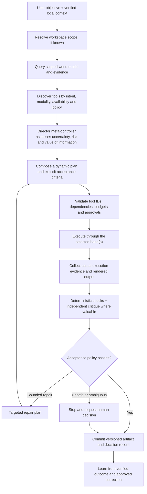

# UX Direct — Universal UX Brain Architecture

**Status:** implementation blueprint and early core primitives  
**Architecture principle:** one general UX intelligence, one evolving product world model, a discoverable universe of executable tools, and dynamic plans bounded by evidence, permissions, budget and verifiable outcomes.

## 1. The core architectural correction

Do not build a DMI brain, a Ujjivan brain, a loan-design brain or a collection of fixed UX workflows. Build one general director controller.

The Brain should be able to reason about a new domain, identify missing knowledge, discover useful tools, construct a task-specific plan, execute through available hands, verify outcomes and improve from approved evidence.

Project context is not a limit on intelligence. It describes the environment in which the intelligence is acting: facts, artifacts, decisions, constraints, permissions, provenance and current state. Workspace identifiers exist for retrieval scope, tenancy, safety and traceability—not to select a different reasoning engine.

A capability registry describes executable affordances, schemas, modalities, costs and safety restrictions. It must not become a list of all tasks the Brain is permitted to imagine. The planner may compose novel workflows from compatible available tools; execution is limited by actual tool support and policy.

## 2. Intelligence, world state, tools and policy are separate planes

### Cognition plane

The director controller receives the user's objective, relevant world-model slice and available tool descriptions. It decides what is uncertain, which evidence or operations would reduce meaningful uncertainty, how to order work, and what success would look like. It can use approved reusable recipes, but no client-specific workflow is mandatory by code.

### World-model plane

The product world model represents versioned entities, claims, decisions, user needs, requirements, constraints, journey states, components, risks and artifacts. Claims carry evidence/provenance, confidence, status, scope, version and optional validity. Relationships capture dependency, contradiction, support, implementation and supersession.

RAG may retrieve source material; the world model connects claims and artifacts and enables impact/contradiction reasoning. It is not a replacement for source documents. Important claims should retain links to their supporting evidence.

### Tool plane

Tools are discovered at runtime. Each tool declares:
- ID and version, purpose, input validation, output/evidence contract.
- Operation kind (observe, research, reason, transform, write).
- Supported modalities and relevant intent tags.
- Provider/hand, current availability, risk and cost class.
- Permission/approval requirements and deterministic postconditions.

Hands register or expose tools. Cockpit is the primary daily hand; Wireframe Foundry, UX Auditor, Benchmark Lab, Journey Architect and Quality/Handoff provide additional execution surfaces. A specialist's existence does not mean every task should invoke it.

### Policy plane

Policy remains independent from model judgment. It enforces workspace data scope, actual Figma permission boundaries, action allowlists, human approvals, budget reservations, operation limits, source/licence constraints and irreversible-action safeguards.

The Brain may propose any useful plan; it may only execute a plan whose tools and operations pass policy. A model must not be able to grant itself permissions by producing persuasive text.

## 3. Request-to-outcome control loop

The planner must never declare that a Figma mutation succeeded merely because a model returned a success-shaped response. The hand returns created/changed node IDs, before/after fingerprints and other available evidence; the verification layer inspects the actual result.

## 4. Runtime tool discovery, not workflow-specific branches

The shared tool registry is an execution catalogue. The Brain filters by actual availability, schemas, modalities, risk policy, project access, budget and approval—not by a hardcoded client-task taxonomy.

Example: the same generic tools may be composed to create a new bank's journey, adapt an existing DMI screen, or investigate a completely new product type:
1. Inspect available artifacts and extract the objective.
2. Retrieve the relevant evidence and constraints.
3. Discover unknowns that materially affect the solution.
4. Invoke research, journey reasoning, visual analysis or Figma execution only where they reduce risk or improve the result.
5. Construct and validate a design representation.
6. Execute and verify through a permitted hand.
7. Record decisions and learn from accepted outcomes.

These are reasoning options, not a compulsory seven-step recipe. The planner may omit, reorder or repeat steps when dependencies allow it. A registry item should represent a tool or reusable skill with an input/output contract, not an independent hardcoded brain.

## 5. Value-of-information controller

Premium reasoning or specialist research should be used only if it is expected to change a material decision. A conceptual decision rule is:

`VOI(action) = expected loss before evidence - expected loss after evidence - action cost`

The runtime need not claim to calculate objective real-world loss accurately. It can use calibrated proxies: severity, uncertainty, downstream blast radius, reversibility, provider cost, latency and historical acceptance rate.

Examples:
- A second visual review is unnecessary if deterministic checks already prove the requested local change and the visual delta is trivial.
- A conflicting approved requirement should block the affected decision and request resolution, not trigger an expensive model guessing what the client intended.
- A benchmark search is worthwhile when a greenfield decision has material uncertainty and trusted sources can meaningfully reduce it.
- A new workspace does not automatically trigger a long greenfield workflow; the controller inspects the available state and selects only useful work.

## 6. Design compiler and intermediate representation

LLMs should not translate every prompt directly into arbitrary Figma API mutations. Convert task intent into a validated Design IR first.

The Design IR should represent semantic meaning independently of Figma nodes:
- User goal, task preconditions and completion conditions.
- Journey states, transitions, branches and recovery paths.
- Screen purpose, information groups, fields, actions, data source references and content constraints.
- Component/pattern references, layout constraints, interaction states and responsive intent.
- Required invariants, assumptions, evidence links and unresolved questions.

A deterministic compiler/adapter maps Design IR into allowed Figma operations. After execution, the evaluator compares the intended semantics against the actual result. This separates a visual change from a semantic regression: rearranging sections is not equivalent to deleting a required condition.

The same IR can support different Figma hands or future execution targets without duplicating core reasoning.

## 7. Journey verification and counterexample generation

Model journeys as state-transition graphs, not merely ordered screens. Verify reachability, required states, invalid transitions, retry termination, cancellation/exit behaviour, data/consent preconditions and success-state conditions.

For example, run generated paths such as:
- User abandons during document upload.
- Network disappears during submission and the user returns.
- A request times out but later completes.
- A user changes an earlier answer.
- A retry is repeated or re-entered through a deep link.
- A required screen or confirmation is skipped.

The verifier should report concrete counterexamples tied to a transition or invariant. It must separate machine-verified properties from model-judged UX quality and human-owned business/compliance decisions.

## 8. Independent quality architecture

Use a cascade, not a costly always-on committee:
1. **Deterministic checks:** schema validity, required content, node IDs, allowed properties, preservation of originals, invariant coverage and action results.
2. **Visual evaluation:** actual rendered output for hierarchy, spacing, clipping, legibility, visual consistency and unintended regressions.
3. **Adversarial critique:** attempt to disprove important assumptions, identify missing states and contradictions, and find failure paths.
4. **Acceptance policy:** accept, repair within a strict attempt budget, request human approval, or stop.

A generator must not be its own sole judge. Prefer a distinct evaluator or materially independent evaluation process for high-impact changes. A nominal 90/100 score has no authority until calibrated against human-reviewed examples and known failures.

## 9. Multi-timescale memory and controlled learning

Separate:
- **Working memory:** task-local context, expires unless deliberately saved.
- **Episodic memory:** task events, execution traces, failures, corrections and acceptance outcomes.
- **Semantic memory:** verified facts, approved decisions, requirements and reusable patterns with provenance.
- **Procedural memory:** successful tool sequences or recipes, promoted only after repeatable success.
- **Preference model:** observed human choices and edit deltas, scoped by context and task type.

Compare generated artifacts with human-approved edits. Classify changes as hierarchy, layout, content, component, state coverage, project-rule violation or preference. Store correction as a candidate insight; promote it to a rule only after approval or adequate repeated evidence.

Do not store private chain-of-thought. Store concise decision records: chosen action, alternatives considered, evidence sources, constraints, trade-offs, confidence/unknowns, approver and validation outcome.

## 10. World model and workspace isolation

Workspace context is a data boundary, not a different Brain.

- Project-scoped facts are visible only within their exact project namespace.
- Client-scoped approved facts can be shared only within the relevant client boundary.
- Cross-client retrieval is limited to explicitly approved generic knowledge with source/licence provenance.
- Inferred claims remain labelled as inferred; disputed, deprecated, stale or unsupported claims must not silently become authoritative.
- When sources conflict, record the conflict and authority of each source; do not average them into a fabricated certainty.
- New workspace IDs must be data-driven. Adding a client must not require new TypeScript enums or planner branches.
- Project metadata may describe known files and current artifacts, but must not prescribe the Brain's mandatory task sequence.

DMI normally provides existing artifacts and approved patterns, so the Brain will frequently choose direct Cockpit work. Ujjivan begins with a new product context, so the Brain may decide that benchmarking, journey modelling and Wireframe Foundry are useful. This is an inference from current evidence and task state—not a hardcoded DMI/Ujjivan workflow. After a kit is approved, the Brain should recognise and reuse it.

## 11. Budget and execution reliability

Every tool/capability declares cost class, modality, estimated bound, maximum attempts, expected output evidence and approval policy. Before a paid call:
1. Verify current model/provider price and modality.
2. Estimate the worst-case permitted input/output and reserve against a shared transactional ledger.
3. Refuse paid execution when the ledger or price data is unavailable.
4. Reconcile provider-reported usage/cost where available.
5. Treat a failed provider request as potentially billable; never retry blindly.

The Wireframe Foundry may use a per-run ceiling such as INR 50, but that cap is an execution policy rather than a client profile or reasoning rule. Reserve budget for verification/repair and fail early if the expected request will not fit. Local deterministic checks should be preferred whenever they answer the question.

## Capability growth and the learning feedback loop

Treat new domains as additions to the capability surface, not new brains. A website or application capability declares its version, tags, modality, input/result contract, availability, cost/risk and required approvals; the planner discovers it at runtime and composes it with other available tools. A registered capability does not imply its adapter is connected or authorized.

Execution feedback is recorded as compact evidence (outcome, validation, human correction, cost/latency where available and scope). Repeated success can influence advisory capability/strategy ranking. Failed outcomes and human corrections also count as evidence. Recommendations require a minimum sample and quality/verification thresholds; they can never expand allowlists, grant write permission, bypass approvals or spend controls. Project and client signals remain scoped, while cross-client learning needs explicit approved generic licensing. Do not store raw prompts, screenshots, design payloads or private chain-of-thought in the learning ledger.

Implementation: `src/core/capability-registry.ts` provides dynamic discovery and gated execution, `src/core/capability-learning.ts` exposes the evidence loop and injectable repository contract, and `director-controller.ts` can pass scoped preferences to the planner. The initial learning repository is in-memory only; persistent authenticated storage and real execution-evidence wiring remain production tasks.

## 12. Current implementation scaffold

This branch introduces:
- `world-model.ts`: versioned claims/evidence/relations with project/client/global scope filtering.
- `tool-registry.ts`: runtime discovery and policy-checked invocation of declared tools.
- `director-controller.ts`: planning context assembly and validation for dynamically composed plans.
- `workspace-context.ts`: data-driven workspace metadata without hardcoded workflow sequences.
- `hand-contracts.ts`: shared hand contracts; workspace IDs are strings rather than a closed project enum.
- Tests for scope isolation, discovery, approval/budget gates, dependency cycles and adaptive plans.

These are core primitives and reference implementation—not yet the production Brain end-to-end. In particular, persistent world-model storage, the actual server-side model planner, real tools registered from connected Figma hands, transactional budget integration and live post-mutation verification still need wiring.

## 13. Implementation sequence

1. Validate/build these contracts and tests.
2. Persist world facts, evidence and relations in the existing data layer with workspace-scoped authorization.
3. Add a server-owned planning endpoint that accepts task intent and a verified local context envelope; keep credentials and routing server-side.
4. Register actual tool implementations with real input schemas, availability/health checks, postconditions and operation permissions.
5. Add Design IR schema/compiler and execution evidence protocol.
6. Connect Cockpit first; prove it can inspect, plan, execute and verify a bounded real task.
7. Add Wireframe Foundry, then research/audit/journey/quality tools as independent providers of capabilities.
8. Calibrate acceptance and learning on a human-reviewed evaluation set before enabling autonomous high-impact execution.

## Acceptance criteria

- A new workspace can be registered as data without adding a client enum or planner branch.
- A task with no known workspace can still use general tools or ask for the missing context.
- The Brain can discover tools dynamically and create a non-linear plan rather than following a required client sequence.
- Unknown/unavailable tools, unsupported modalities, missing evidence, dependency cycles, unauthorised writes and unreserved paid calls are rejected before execution.
- World-model queries cannot leak client/project facts across scopes; generic facts require explicit namespace and licence approval.
- The Brain reports only verified mutations as completed.
- Tests assert the above properties; deployment remains separate from feature-branch architecture work.
